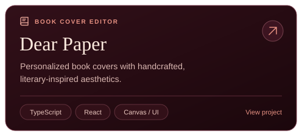
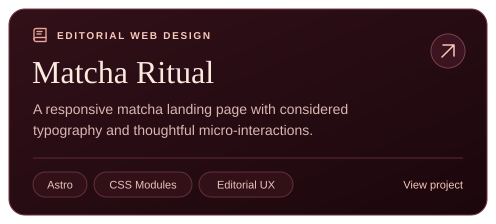
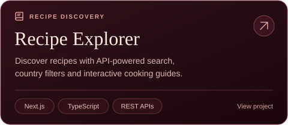
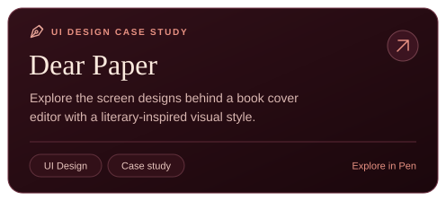

  <!-- Header Banner -->
  

 

  

    <strong>Software Engineer · Frontend Specialist · Full-Stack Developer</strong> 
    <em>9+ years in software development. Frontend is my specialty; building complete web applications is part of my everyday work.</em>
  

  

    
    
    
  

---

## 🌺 About Me

- 💻 I’ve spent **9+ years working in software development**, with **frontend as my core specialty**.
- 🎨 I care about how an interface looks, feels, and behaves — from typography and layout to the details of an interaction.
- 🛠️ I work across **frontend and backend**, building complete applications while continuing to deepen my full-stack expertise.
- 🍵 Happy to talk frontend, compare approaches to a tricky UI, or take a break for matcha.

---

## ✦ Featured Projects

  
  
   
  
  

---

## ✦ Tech Stack & Tools

| Area                  | Technologies & Tools                                                                                                   |
| :-------------------- | :--------------------------------------------------------------------------------------------------------------------- |
| **Frontend**          | `TypeScript` `JavaScript` `React` `Next.js` `Astro` `Vue.js` `Angular` `HTML5` `CSS3` `Tailwind CSS` `Web Performance` |
| **Backend**           | `Node.js` `PHP` `REST APIs`                                                                                            |
| **UX/UI Design**      | `Responsive Design` `Design Systems` `UI/UX Prototyping`                                                               |
| **Development Tools** | `Git` `GitHub` `GitHub Actions`                                                                                        |

 

  

---

## ✦ GitHub Activity & Metrics

  <table>
    <tr>
      <td align="center" valign="top" width="50%">
        
      </td>
      <td align="center" valign="top" width="50%">
        
      </td>
    </tr>
  </table>
  
   
  
  

---

Designed by Gisela Rosibel Scarpin 🌺

